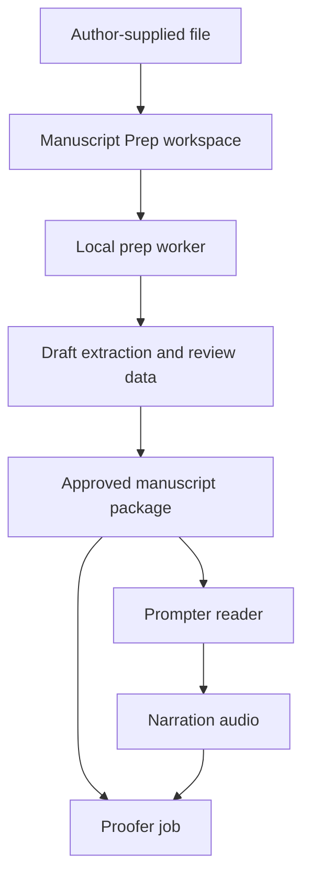
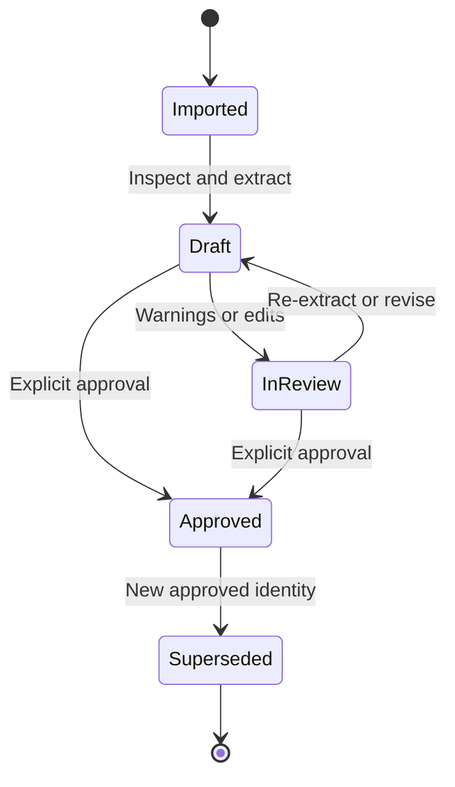

# Prompter Architecture

## Purpose

This document records the technical boundaries and durable data contracts for
the Prompter suite. It is the implementation companion to the Manuscript Prep
product requirements: requirements say what the tool must do; this document
says who owns each concern and how its data moves safely through the suite.

It is a living architecture document. Changes that affect component ownership,
approved-manuscript identity, IPC, or security guarantees should update it.

## Principles

1. **One desktop shell, separate engines.** Prompter is the Windows-first
   Electron/React/TypeScript workspace. Specialist processing remains behind
   explicit module and process boundaries.
2. **Local first.** Manuscripts, passwords, audio, transcripts, and analysis
   stay on the machine unless the narrator deliberately chooses otherwise.
3. **The source is sacrosanct.** Author-supplied files are read-only. Generated
   and reviewed text are new artifacts, never edits to the supplied original.
4. **Approval is explicit.** A draft extraction is never silently treated as
   narration- or proof-ready.
5. **Artifacts have identities.** Approved text is immutable and hashed.
   Existing reading sessions and proof jobs retain their exact text identity.
6. **Evidence beats plausibility.** Tools may flag and propose; they must not
   quietly rewrite author wording or present uncertain extraction as authority.
7. **Boundaries are real.** Manuscript Prep owns input preparation, Prompter
   owns reading/performance state, and Proofer owns audio/text comparison.

## Suite topology



Manuscript Prep is a Prompter workspace, not another standalone app to manage.
Its extraction, document rendering, OCR, and diagnostics run in a local worker,
so that processing complexity does not leak into the Electron renderer.

| Component | Owns | Does not own |
| --- | --- | --- |
| Prompter shell | Workspaces, project navigation, keyboard workflow, reader UI, session/reading position | Extraction, OCR, PDF parsing, Proofer policy |
| Manuscript Prep UI | Import flow, report, source/text review, review edits, approval control | Live scrolling, audio capture, ASR comparison |
| Prep worker | File probing, adapter extraction, PDF routing/rendering, OCR, diagnostics, source mapping, package creation | Electron UI, project navigation, editorial decisions |
| Proofer | Audio/transcript processing, comparison to approved text, tiers, markers, job history | Document ingestion, OCR, source-text approval |
| Future Delivery Prep | Audio validation and delivery/export | Manuscript approval and proof analysis |

## Book project lifecycle

Each book has one Prompter project. The project records references to artifacts;
it is never a place to overwrite text that an earlier session or proof job used.



A later correction creates a new approved package. Prompter changes its active
manuscript only through an explicit user action; completed proof jobs continue
to reference the earlier identity.

### Logical on-disk layout

The root is user-configured. This is a logical layout, not a Git directory;
manuscript content, author paths, decrypted documents, and local caches are
ignored by source control.

```text
Book Project/
  project.json
  source/                         # optional, user-approved read-only copy
  manuscript-prep/
    drafts/
      <draft-id>/
        extraction.json
        blocks.json
        diagnostics.json
        review.patch               # only when review edits exist
        pages/                     # retained preview cache, if any
    approved/
      <approved-id>/
        manuscript.txt
        provenance.json
  prompter/
    settings.json
  proofer/
    jobs/
      <job-id>/
        job.json
```

`project.json` holds references and the active approved-manuscript ID, not source
text or secrets. A source file may remain in its original location. If a copy
is archived, the choice is deliberate and the archived source remains read-only.

## Manuscript Prep model

Extraction creates a canonical **review document**, not merely a string. It is
an ordered collection of blocks. Each block records:

- a stable draft-local ID and position;
- type: paragraph, heading, chapter break, table, caption, or note;
- original extracted text and any user-edited replacement;
- source locator: document structure location or PDF page/region when known;
- extraction route: native, OCR, or mixed;
- linked confidence and diagnostics.

The UI presents editable text while preserving enough mapping to jump from a
warning to its originating page. `manuscript.txt` is a deterministic serialization
of the reviewed blocks: UTF-8, normalized Unicode, and stable line endings.

### Extraction routes

| Input | Primary route | Rule |
| --- | --- | --- |
| TXT/TEXT | Validate encoding and normalize line endings | Do not reinterpret wording or layout. |
| DOCX/EPUB/RTF/HTML | Structured extractor adapter | Preserve paragraph/chapter boundaries where recoverable. |
| Healthy text PDF | Embedded text extraction | Record direct extraction explicitly. |
| Corrupt/missing PDF text | Per-page rendered OCR | Label OCR material and uncertainty. |
| Scanned PDF | Rendered OCR | Record page-level confidence. |
| Standard password PDF | Unlock in memory, then applicable route | Never store/log password. |
| DRM/certificate/unreadable input | Stop with clear explanation | Never circumvent access controls. |

PDF routing is page-aware rather than one global decision. Native text is scored
for linguistic plausibility and suspect pages are checked against rendered/OCR
samples. A visually readable PDF whose text layer yields gibberish - including
the required *corrupt-text PDF* regression - is a failed extraction.

### Diagnostics and editing

The worker emits structured diagnostics: severity, category, message, affected
block/page range, and suggested action. Required categories include empty or
non-linguistic text, Unicode errors, missing boundaries, repeated headers or
footers, line-end hyphenation, boilerplate, tables/notes/captions, image-only
pages, corrupt PDF text, and OCR confidence.

Automatic processing may safely normalize encoding and line endings. It may
identify removal candidates, but it never silently removes front matter, end
matter, headers, footers, or merely unusual text. Narrator changes are stored
as a patch over extracted text, making corrections reproducible and auditable.

## Approved-manuscript contract

Approval atomically creates `approved/<approved-id>/`:

| File | Contract |
| --- | --- |
| `manuscript.txt` | UTF-8 plain text, normalized Unicode and stable line endings; no hidden formatting, fonts, images, or PDF objects. |
| `provenance.json` | Machine-readable record of source, extraction, diagnostics, review, approval, and identities. |

Provenance includes the original filename, format, size, SHA-256 and source
reference; extraction method and tool version; a password-used boolean only;
OCR engine/version and confidence summary where relevant; warnings present at
approval; review-patch/edit summary; output SHA-256 and size; and timestamp.
It never contains a password. The output hash is verified before success is
reported. `approved-id` is generated; the text SHA-256 is the content identity.

## Process and IPC

The Electron main process starts and supervises a local Manuscript Prep worker.
Renderer code never directly executes file parsers or OCR binaries. The initial
transport is a versioned JSONL protocol over stdin/stdout, or an equivalent
authenticated local-only IPC transport.

| Command | Purpose |
| --- | --- |
| `inspect` | Probe actual type, access/encryption state, and structural counts. |
| `extract` | Create a draft, select routes, extract blocks, and emit diagnostics/progress. |
| `render_page` | Render a permitted source page for review preview. |
| `apply_review_change` | Validate/store a deliberate edit or review action against a draft revision. |
| `approve` | Validate current review state and atomically create an approved package. |

Requests carry `protocolVersion`, `requestId`, and appropriate project/draft IDs.
Responses echo `requestId` and return structured status/error codes. Passwords
are supplied only in memory for the active operation and never included in
diagnostics. The shell owns progress, cancellation UI, retry, and worker
recovery; the worker owns safe/idempotent artifact writes and rejects ambiguous
overwrites.

Python is the initial likely worker implementation because of its document and
OCR ecosystem. The architecture depends on the IPC and package contracts, not
on that language choice; a future cross-platform worker may replace it.

## Proofer integration

Proofer accepts an approved `manuscript.txt` identity, never a raw import or draft.
At creation, `job.json` records:

- approved manuscript ID and text SHA-256;
- provenance identity/version when present;
- resolved read-only reference to the approved text;
- Proofer and alignment configuration versions.

This makes historical results meaningful. A later approved text can be used by
new jobs without altering prior detection, alignment, tiering, or marker output.
Manuscript Prep must not contain audio, transcription, alignment, tiering, or
marker-policy logic.

## Security and filesystem rules

- Extraction and OCR run locally by default.
- Passwords exist only in active-session memory and are excluded from logs,
  IPC diagnostics, artifacts, crash reports, and Git.
- Inputs are opened read-only; outputs use a separate user-approved directory.
- Path validation rejects traversal, source overwrite, symlink escape, and
  accidental package replacement.
- When an archived source is used, its hash is checked before and after work.
- Drafts, preview renders, OCR caches, source copies, and approved packages
  have an explicit future retention/cleanup policy; none is deleted silently.

## Failure handling

| Condition | Required behavior |
| --- | --- |
| Wrong/missing PDF password | Explain, allow retry, retain no password. |
| DRM/certificate protection | Stop and request authorized access or a readable source. |
| Corrupt native PDF text | Preserve evidence, OCR affected pages, require visible review. |
| Partial OCR failure | Flag exact pages; never imply complete extraction or approval. |
| Worker crash/cancellation | Preserve only explicitly incomplete drafts; never claim approval. |
| Source changes during import | Stop/flag and require a new import identity. |
| Approval write/hash failure | Quarantine/remove incomplete output; do not update active manuscript. |

## Testing and v1 regression set

The worker is independently testable through its command protocol; the shell
tests workspace state and IPC integration separately. Fixtures must be
synthetic, licensed for repository use, or excluded if they contain author work.

1. Clean TXT, DOCX, and EPUB preserve usable paragraph boundaries.
2. A healthy text PDF chooses native extraction and reports that route.
3. *corrupt-text PDF* rejects unusable native text and uses OCR rather than
   emitting Unicode gibberish.
4. A scanned PDF has page-level OCR confidence diagnostics.
5. A password PDF works after local entry, with no password in logs/artifacts.
6. DRM/unreadable files stop safely with clear guidance.
7. Source input is byte-identical after all operations.
8. Approval yields hash-verified `manuscript.txt` and `provenance.json`.
9. Proofer consumes approved text without detector changes.

## Deliberate deferrals

The following are not yet architecture commitments:

- final OCR engine/model and packaging;
- ODT and legacy DOC conversion;
- a user-facing retention/cleanup interface;
- author pronunciation-note artifacts;
- Delivery Prep implementation;
- cross-platform packaging beyond the portable worker boundary.
